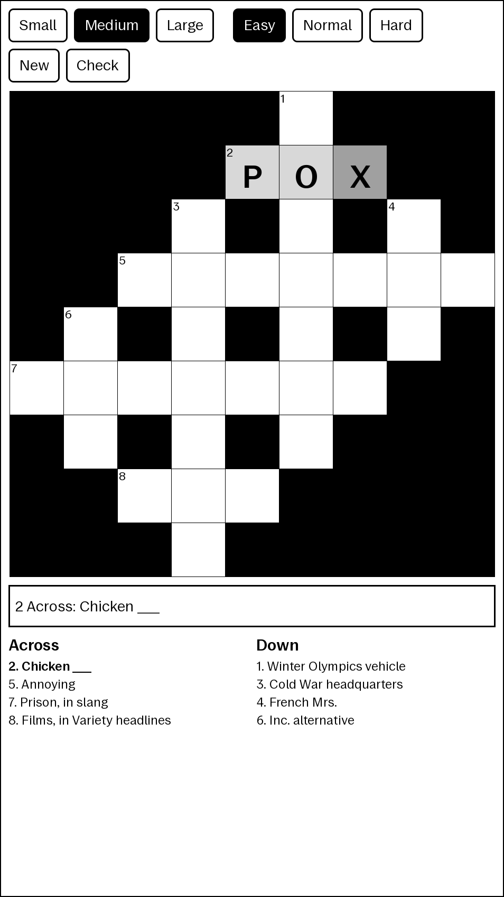

# reCrossable

Simple crossword game for the reMarkable tablet: write letters in the squares with the pen.



Uses [CWC](http://cwordc.sourceforge.net/) for generating crosswords, and a
simple neural net using [dlib](http://dlib.net/) for recognising characters.

## Running on the tablet

reCrossable is an [AppLoad](https://github.com/asivery/rm-appload) application,
for reMarkable OS 3.x with xovi and AppLoad installed. It's made of:

- `ui/main.qml`: the frontend, loaded by AppLoad inside xochitl
- `backend/`: the backend process, which generates crosswords and recognizes
  letters, talking to the frontend over AppLoad's socket

## Word lists

`wordlists/` has one clue list per difficulty, built from the
[xd crossword corpus](https://xd.saul.pw/data/) by `tools/build_wordlists.py`.
Difficulty is approximated by publication: Easy comes from USA Today and
Universal, Normal from the LA Times, Newsday and CrosSynergy, Hard from the New
York Times and the Wall Street Journal.

## Building

The backend is built with CMake. dlib is downloaded and compiled in, unless
`DLIB_SOURCE_DIR` points to an extracted dlib source tree.

Everything needed is in the [nix-remarkable-sdk](https://github.com/cyprienruffino/nix-remarkable-sdk) dev shell:

```sh
nix develop github:cyprienruffino/nix-remarkable-sdk
```

For the Paper Pro family:

```sh
cmake -B build-rm -G Ninja -DCMAKE_TOOLCHAIN_FILE=$RM_TOOLCHAIN_FILE
cmake --build build-rm
cmake --install build-rm --prefix dist/recrossable
rm-deploy dist/recrossable
```

`rm-deploy` installs it in `/home/root/xovi/exthome/appload/` on the tablet
(reopen the app to use the new version); `rm-logs recrossable` follows its logs.

## Developing on a PC

The backend can generate a puzzle on its own:

```sh
cmake -B build-pc -G Ninja && cmake --build build-pc
cmake --install build-pc --prefix dist-pc/recrossable
cd dist-pc/recrossable && ./backend/entry --generate easy ginsberg
```

The frontend can be previewed and tested against a mock of AppLoad, which
serves `dev/fixture-puzzle.json`:

```sh
QML_XHR_ALLOW_FILE_READ=1 qml -I dev/mock dev/preview.qml
QML_XHR_ALLOW_FILE_READ=1 qmltestrunner -import dev/mock -input dev/tests
```

## Thanks

reCrossable was written by [sandsmark](https://github.com/sandsmark) for the
reMarkable 1: this is a port of the [original reCrossable](https://github.com/sandsmark/recrossable)
to current reMarkable OS, with its crossword generator and letter recognizer.
Thanks as well to [CWC](http://cwordc.sourceforge.net/) for the crossword
compiler, the [xd crossword corpus](https://xd.saul.pw/data/) for the clues, and
[AppLoad](https://github.com/asivery/rm-appload) for making apps like this
possible on the Paper Pro.
